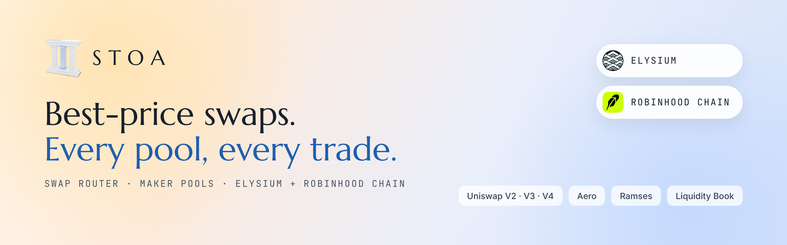
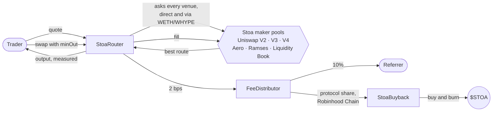

<p align="center">
  <a href="https://stoadex.com"></a>
</p>

<p align="center">
  <a href="https://stoadex.com"><b>stoadex.com</b></a> ·
  <a href="https://stoadex.com/docs">Docs</a> ·
  <a href="https://stoadex.com/token">$STOA</a> ·
  <a href="https://x.com/StoaDEX">X / @StoaDEX</a>
</p>

<p align="center">
  <a href="https://github.com/StoaDex/Stoa/actions/workflows/ci.yml"></a>
  
  
  
  
  
  <a href="https://explorer.twigpine.com/repos/z6Mkogs4MbcB3pBnpQygxpgWtt6LTJSCbmpiBhRBHgHvnMRt/stoa"></a>
</p>

<p align="center">

[](https://heyresearch.xyz/project/stoadex-stoa?utm_source=badge&utm_medium=readme)

</p>

> **#BuildwithCMC:** the MCP server at `stoadex.com/mcp` now has a `market_context` tool built on the CoinMarketCap API. See [hackathon/cmc](hackathon/cmc/README.md).

# Stoa

Stoa is a swap router with maker-quoted pools (PropAMM). Every swap is quoted against every venue the router knows on the network: Stoa maker pools, Uniswap V2, V3 and V4, Aero, Ramses and Liquidity Book. It fills where the trader gets the most, directly or through the wrapped native token. Stoa charges a flat 2 bps protocol fee, once per swap (a route through two Stoa maker pools pays each pool's fee; see [Fees](web/content/docs/fees.md)).

It is live on **Elysium** (chain 99901) and **Robinhood Chain** (chain 4663).

## How a swap works



- **The router never trusts a venue.** It measures what the trader actually receives and reverts below `minOut` (standard tokens; see K-1 in the security review for tokens that tax transfers). Venues are allowlisted adapters; new ones wait in public before they go live.
- **Maker pools** are quoted every block by bonded makers. When no maker quotes, swaps still fill on the best outside venue.
- **Uniswap V4 pools** are registered permissionlessly in Stoa's adapter, limited to hooks on an allowlist fixed at deployment.

## Governance and security

| | Elysium | Robinhood Chain |
| --- | --- | --- |
| Router | [`0x1047…7dbA`](https://elysium.kinetiq.xyz/address/0x104752D50ef893da579Ad813918269e09Ea17dbA) | [`0x2F28…3eE5`](https://robinhoodchain.blockscout.com/address/0x2F2804fad735a38015650f32f95Ad5E08D6B3eE5) |
| Owner of every contract | 48h timelock [`0xeBa0…417B`](https://elysium.kinetiq.xyz/address/0xeBa02cCc1f724Cd098fc20492EF9313e1ED2417B) | 48h timelock [`0xAC75…3ed8`](https://robinhoodchain.blockscout.com/address/0xAC75133729d6B5d615aA696d0828dC31fcB83ed8) |
| Proposer and executor | 2-of-3 Safe [`0xBF71…055F`](https://elysium.kinetiq.xyz/address/0xBF715C84b1C0759C87Da368c1476b80ac0C5055F) | 2-of-3 Safe [`0xa1a4…D386`](https://robinhoodchain.blockscout.com/address/0xa1a495484536c52046d07209C60059cf9613D386) |

- **No upgradeable code.** No proxies; a fix is a new deployment.
- **Every owner action waits 48 hours in public**, and a new venue waits another 24 hours in the router itself. A guardian wallet can only pause swaps.
- **Every contract is source-verified on Sourcify** (exact match), so the code here is the code that runs.
- **Not audited yet.** Maker pools cap each fill at $500 and public LP vaults stay closed until an external audit. Design guarantees, trusted roles and known limits: [`contracts/SECURITY.md`](contracts/SECURITY.md).

Every address: [docs/contracts](https://stoadex.com/docs/contracts), or [`web/lib/deployments.json`](web/lib/deployments.json) (Elysium) and [`web/lib/deployments-4663.json`](web/lib/deployments-4663.json) (Robinhood Chain).

## $STOA

[`0x13E6…6718`](https://robinhoodchain.blockscout.com/address/0x13E6993417616De724F2b337D65063f229e96718) on Robinhood Chain, launched on Pons. Two jobs, both enforced by contracts:

1. **Buyback and burn.** `StoaBuyback` owns the Robinhood Chain FeeDistributor. Protocol fees can only leave it as a swap into $STOA through the Stoa router, burned in the same transaction. A keeper runs it weekly.
2. **Maker bonds.** Makers bond $STOA in `BondRegistry` to quote Stoa pools on Robinhood Chain. Slashed bonds are burned.

$STOA pays no fee share and no yield. Details: [docs/token](https://stoadex.com/docs/token).

## Repository

| Folder | What | Stack |
| --- | --- | --- |
| [`contracts/`](contracts) | Router, maker pools, venue adapters, fee distributor, buyback, bond registry; deploy and governance scripts; unit, attack and live fork tests | Solidity 0.8.28, Foundry |
| [`web/`](web) | stoadex.com: trade, pools, earn, curators, $STOA, referrals, portfolio, admin console, docs | Next.js 15, wagmi, viem, three.js |
| [`web/content/docs/`](web/content/docs) | The documentation at stoadex.com/docs | Markdown (GitBook format) |
| [`maker/`](maker) | Maker bot: quotes a Stoa pool every block from the Hyperliquid order book, with risk limits | TypeScript, viem |
| [`.github/workflows/`](.github/workflows) | CI, deployments, monitoring and the scheduled jobs below | GitHub Actions |

## Development

Requirements: [Foundry](https://book.getfoundry.sh), Node 22.

```bash
git clone --recurse-submodules <repo-url> && cd stoa

# contracts: build, unit and attack tests
cd contracts && forge build && forge test

# live fork tests (read-only, against mainnet state)
ELYSIUM_RPC_URL=https://rpc.elysium.kinetiq.xyz forge test --match-contract "ForkElysium|ForkVenues"
ROBINHOOD_RPC_URL=https://rpc.mainnet.chain.robinhood.com forge test --match-contract ForkRobinhood

# web app
cd ../web && npm install && cp .env.example .env.local && npm run dev

# maker bot (dry run)
cd ../maker && npm install && cp .env.example .env && npm run build && DRY_RUN=1 npm start
```

The contracts have 93 tests: 73 unit and attack tests (including fuzzing) and 20 fork tests that trade against live pools, run governance through the real Safe and timelock, and check every allowed Uniswap V4 hook with a real buy and sell.

## Automation

| Workflow | When | What |
| --- | --- | --- |
| CI | every push | `forge fmt`, build with sizes, unit and Elysium fork tests; web and maker tests |
| Health check | hourly | site up, router not paused and quoting, keeper gas |
| Refresh Uniswap V4 pools | daily | ranks the most traded V4 pools and registers new ones on both chains |
| $STOA graduation watcher | every 10 min | registers $STOA's Uniswap V4 pool as soon as it leaves the Pons curve |
| Robinhood governance steps | hourly while pending | moves timelocked Safe actions forward when they are due |
| $STOA buyback & burn | weekly | turns Robinhood Chain protocol fees into burned $STOA |
| Deploy / smoke swap | manual | dry run first, then broadcast; real swap round trip on mainnet |

## Security

Please report vulnerabilities privately: see [SECURITY.md](.github/SECURITY.md). Do not open a public issue for them.

## License

The smart contracts in [`contracts/src`](contracts/src) are MIT licensed ([`contracts/LICENSE`](contracts/LICENSE)), as their SPDX headers state. The web app, maker bot, docs and brand assets are © Stoa, all rights reserved.
